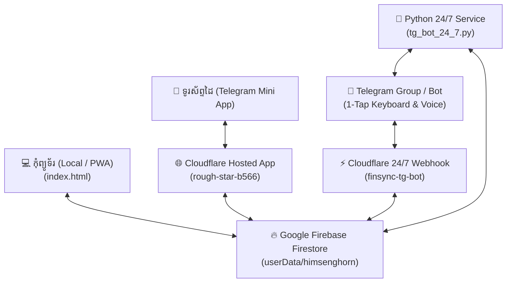
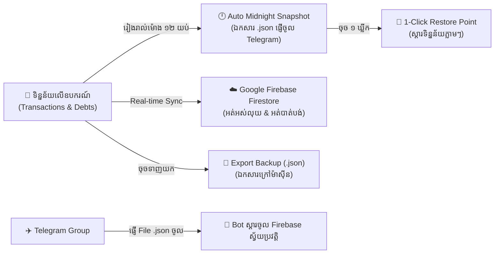

# 📖 សៀវភៅណែនាំការប្រើប្រាស់ប្រព័ន្ធ FinSync Pro
### FinSync Pro — Enterprise Financial Operating System & 24/7 Cloud POS Ecosystem
**កំណែប្រព័ន្ធ:** Enterprise v10.5 (Mega 10 Suite Edition)  
**ម្ចាស់ប្រព័ន្ធ / គណនីចម្បង:** `himsenghorn`  
**កាលបរិច្ឆេទធ្វើបច្ចុប្បន្នភាព:** ខែវិច្ឆិកា ឆ្នាំ២០២៦  

---

## មាតិកាសៀវភៅណែនាំ (Table of Contents)
1. [ជំពូកទី ១: ទិដ្ឋភាពទូទៅនៃប្រព័ន្ធ (System Overview)](#ជំពូកទី-១-ទិដ្ឋភាពទូទៅនៃប្រព័ន្ធ-system-overview)
2. [ជំពូកទី ២: របៀបចូលប្រើប្រាស់លើឧបករណ៍នានា (Accessing the System)](#ជំពូកទី-២-របៀបចូលប្រើប្រាស់លើឧបករណ៍នានា-accessing-the-system)
3. [ជំពូកទី ៣: សុវត្ថិភាព ការចាក់សោរ និងការគ្រប់គ្រងបុគ្គលិក (Security & Staff Protection)](#ជំពូកទី-៣-សុវត្ថិភាព-ការចាក់សោរ-និងការគ្រប់គ្រងបុគ្គលិក-security--staff-protection)
4. [ជំពូកទី ៤: ការកត់ត្រាចំណូល-ចំណាយប្រចាំថ្ងៃ (Daily Income & Expense Tracking)](#ជំពូកទី-៤-ការកត់ត្រាចំណូល-ចំណាយប្រចាំថ្ងៃ-daily-income--expense-tracking)
5. [ជំពូកទី ៥: ប្រព័ន្ធប្តូរសៀវភៅកត់ត្រា Multi-Book (អាជីវកម្ម vs ផ្ទាល់ខ្លួន)](#ជំពូកទី-៥-ប្រព័ន្ធប្តូរសៀវភៅកត់ត្រា-multi-book-អាជីវកម្ម-vs-ផ្ទាល់ខ្លួន)
6. [ជំពូកទី ៦: ប្រព័ន្ធគ្រប់គ្រងស្ដុកទំនិញ & Barcode POS (Inventory Management)](#ជំពូកទី-៦-ប្រព័ន្ធគ្រប់គ្រងស្ដុកទំនិញ--barcode-pos-inventory-management)
7. [ជំពូកទី ៧: ប្រព័ន្ធស្វ័យប្រវត្តិតាម Telegram 24/7 (Telegram Bot & 1-Tap Keyboard)](#ជំពូកទី-៧-ប្រព័ន្ធស្វ័យប្រវត្តិតាម-telegram-247-telegram-bot--1-tap-keyboard)
8. [ជំពូកទី ៨: របាយការណ៍ហិរញ្ញវត្ថុ & ការទាញយកឯកសារ Excel/PDF](#ជំពូកទី-៨-របាយការណ៍ហិរញ្ញវត្ថុ--ការទាញយកឯកសារ-excelpdf)
9. [ជំពូកទី ៩: ការគ្រប់គ្រងបំណុល និងការទូទាត់ (Debts & Loans)](#ជំពូកទី-៩-ការគ្រប់គ្រងបំណុល-និងការទូទាត់-debts--loans)
10. [ជំពូកទី ១០: សុវត្ថិភាពទិន្នន័យ ការ Backup & Restore ស្វ័យប្រវត្តិកណ្តាលអធ្រាត្រ](#ជំពូកទី-១០-សុវត្ថិភាពទិន្នន័យ-ការ-backup--restore-ស្វ័យប្រវត្តិកណ្តាលអធ្រាត្រ)
11. [ជំពូកទី ១១: សំណួរញឹកញាប់ និងការដោះស្រាយបញ្ហា (FAQ & Troubleshooting)](#ជំពូកទី-១១-សំណួរញឹកញាប់-និងការដោះស្រាយបញ្ហា-faq--troubleshooting)

---

## ជំពូកទី ១: ទិដ្ឋភាពទូទៅនៃប្រព័ន្ធ (System Overview)

**FinSync Pro** គឺជាប្រព័ន្ធប្រតិបត្តិការហិរញ្ញវត្ថុឆ្លាតវៃកម្រិត Enterprise ដែលត្រូវបានរចនាឡើងដើម្បីបម្រើទាំងការគ្រប់គ្រងចំណូលចំណាយផ្ទាល់ខ្លួន និងអាជីវកម្មខ្នាតតូច-មធ្យម ជាមួយការតភ្ជាប់បច្ចេកវិទ្យា Cloud និង Telegram ដោយរលូន។



### ធាតុផ្សំសំខាន់ៗនៃប្រព័ន្ធ៖
1. **Core Web App (PWA & TMA):** កម្មវិធីគោលផ្អែកលើ HTML5/TailwindCSS ជាមួយស្ថាបត្យកម្ម Offline-First, Ultra-fast Performance និងរូបរាង Cyan & Rose Enterprise Dark Theme។
2. **Google Firebase Cloud Firestore:** មូលដ្ឋានទិន្នន័យកម្រិតពិភពលោក (Multi-region cloud storage) រក្សាទិន្នន័យដោយសុវត្ថិភាព និង Sync ទិន្នន័យ Real-time គ្រប់ឧបករណ៍។
3. **Cloudflare 24/7 Webhook Worker:** ម៉ាស៊ីនបម្រើការ Serverless ដំណើរការ ២៤/៧ ទោះបីបិទកុំព្យូទ័រក៏នៅតែអាចទទួលសារ Telegram និងកត់ត្រាបានជានិច្ច។
4. **Local Python Bot Service:** ម៉ាស៊ីនជំនួយការ Backup កណ្តាលអធ្រាត្រ (Midnight Auto-Backup) និងផ្ញើឯកសារ Excel Statement ផ្លូវការ។

---

## ជំពូកទី ២: របៀបចូលប្រើប្រាស់លើឧបករណ៍នានា (Accessing the System)

លោកអ្នកអាចចូលប្រើប្រាស់ FinSync Pro បានគ្រប់ពេលវេលា គ្រប់ទីកន្លែង និងលើគ្រប់ឧបករណ៍៖

### ជម្រើសទី ១: លើទូរស័ព្ទដៃតាមរយៈ Telegram Mini App (TMA) — *ណែនាំបំផុត*
* **វិធីចូល:**
  1. បើកកម្មវិធី Telegram លើទូរស័ព្ទ (iOS ឬ Android)។
  2. ចូលទៅកាន់ Chat ជាមួយ Bot ឬ Telegram Group របស់លោកអ្នក។
  3. ចុចលើប៊ូតុង **«FinSync App»** ឬ Menu Button ខាងឆ្វេងប្រអប់វាយអក្សរ។
  4. កម្មវិធីនឹងបើកពេញអេក្រង់លើទូរស័ព្ទដៃភ្លាមៗ ដោយមិនបាច់ Install App បន្ថែមពី App Store/Play Store ឡើយ។
* **តំណភ្ជាប់ផ្ទាល់:** `https://rough-star-b566.ahn233744.workers.dev`

### ជម្រើសទី ២: លើកុំព្យូទ័រ (PC / Laptop)
* **វិធីចូល:**
  1. បើក Folder `d:\system\`។
  2. ចុច Double-click លើឯកសារ [index.html](file:///d:/system/index.html) លើ Google Chrome, Microsoft Edge, ឬ Brave។
  3. ឬបើក Browser រួចចូលទៅកាន់ URL: `https://rough-star-b566.ahn233744.workers.dev`។

### ជម្រើសទី ៣: ប្រើប្រាស់តាមរយៈ Telegram Chat ដោយផ្ទាល់
* មិនចាំបាច់បើក App ក៏បាន! គ្រាន់តែវាយអក្សរចូល Telegram ឬចុចលើប៊ូតុង 1-Tap Keyboard នោះប្រព័ន្ធនឹងកត់ត្រាចូលទិន្នន័យស្វ័យប្រវត្តិ។

---

## ជំពូកទី ៣: សុវត្ថិភាព ការចាក់សោរ និងការគ្រប់គ្រងបុគ្គលិក (Security & Staff Protection)

FinSync Pro ត្រូវបានបំពាក់ដោយប្រព័ន្ធសុវត្ថិភាព ៣ ជាន់ ដើម្បីធានាថាទិន្នន័យហិរញ្ញវត្ថុរបស់លោកអ្នកត្រូវបានរក្សាជាការសម្ងាត់ខ្ពស់បំផុត។

### ១. ការចាក់សោរដោយកូដ PIN ៤ ខ្ទង់ (4-Digit PIN Lock)
* **ការកំណត់កូដ PIN ដំបូង:**
  1. ចុចលើរូប **⚙️ Settings** (ជ្រុងខាងលើស្តាំ)។
  2. ជ្រើសរើស **«សុវត្ថិភាព & PIN»**។
  3. វាយបញ្ចូលលេខកូដសម្ងាត់ ៤ ខ្ទង់ដែលអ្នកចង់បាន (ឧទាហរណ៍៖ `1234`) រួចចុច **«រក្សាទុកកូដ PIN»**។
* **យន្តការការពារការទាយលេខកូដ (Anti-Brute Force):** បើវាយខុសលើសពី ៥ ដង ប្រព័ន្ធនឹងចាក់សោរជាបណ្តោះអាសន្នរយៈពេល ៣០ វិនាទី។
* **សង្គ្រោះលេខកូដពេលភ្លេច PIN:** មានប៊ូតុង **«ផ្ញើកូដសម្ងាត់ទៅកាន់ Telegram»** នៅលើផ្ទាំង PIN Lock — ប្រព័ន្ធនឹងផ្ញើ OTP ឬកូដសម្ងាត់ចូល Telegram Group របស់លោកអ្នកភ្លាមៗ។

### ២. ការដោះសោរតាមរយៈ FaceID ឬ ក្រយៅដៃ (WebAuthn Biometrics)
* **របៀបចុះឈ្មោះ FaceID/Fingerprint:**
  1. ចូលទៅកាន់ **Settings ➔ សុវត្ថិភាព & PIN**។
  2. ចុចប៊ូតុង **«👆 ចុះឈ្មោះ FaceID / ក្រយៅដៃ (Biometric)»**។
  3. ផ្ទៀងផ្ទាត់ស្កេនក្រយៅដៃ ឬមុខរបស់អ្នកតាមការណែនាំរបស់ទូរស័ព្ទ ឬកុំព្យូទ័រ។
* **របៀបប្រើប្រាស់:**
  * រាល់ពេលបើកកម្មវិធី ផ្ទាំង FaceID / Fingerprint នឹងបង្ហាញឡើងស្វ័យប្រវត្តិ។
  * គ្រាន់តែដាក់ម្រាមដៃ ឬឱ្យទូរស័ព្ទស្កេនមុខ នោះកម្មវិធីនឹងដោះសោរក្នុងរយៈពេលត្រឹមតែ **១ វិនាទី** ប៉ុណ្ណោះ!

### ៣. មុខងារការពារទិន្នន័យសម្រាប់បុគ្គលិក (Staff / Cashier Mode)
> [!IMPORTANT]
> ប្រសិនបើលោកអ្នកប្រគល់កុំព្យូទ័រ ឬទូរស័ព្ទឱ្យបុគ្គលិកគិតលុយ (Cashier) ប្រើប្រាស់ សូមបើកមុខងារនេះ!

* **របៀបបើក:** ចូល **Mega 10 Suite ➔ ផ្ទាំង «Excel & Staff» ➔ បើកកុងតាក់ «Staff Mode»**។
* **ប្រសិទ្ធភាពការពារ:**
  * បុគ្គលិក **អាច**៖ លក់ទំនិញ, ស្កេនបាកូដ, កត់ត្រាចំណូលចំណាយប្រចាំថ្ងៃ។
  * បុគ្គលិក **មិនអាច**៖ លុបប្រតិបត្តិការចាស់ៗ, កែប្រែប្រវត្តិហិរញ្ញវត្ថុ, ឬលុបទំនិញក្នុងស្ដុកឡើយ (តម្រូវឱ្យមាន Admin PIN ទើបអាចលុបបាន)។

---

## ជំពូកទី ៤: ការកត់ត្រាចំណូល-ចំណាយប្រចាំថ្ងៃ (Daily Income & Expense Tracking)

FinSync Pro ផ្តល់ជម្រើសកត់ត្រាច្រើនបែប ដើម្បីផ្តល់ភាពងាយស្រួលបំផុតតាមកាលៈទេសៈ៖

### ១. ការកត់ត្រាតាម Smart Quick Input (វាយបញ្ចូលលឿន)
នៅផ្នែកខាងលើនៃផ្ទាំងកម្មវិធី មានប្រអប់វាយអក្សរឆ្លាតវៃ៖
* **ឧទាហរណ៍វាយបញ្ចូល:**
  * `បាយថ្ងៃត្រង់ 12000៛` ➔ កត់ត្រាចំណាយ 12,000 ៛ ក្នុងប្រភេទ «ម្ហូបអាហារ»
  * `កាហ្វេ $1.50 aba` ➔ កត់ត្រាចំណាយ \$1.50 កាត់ពីកាបូប ABA Bank
  * `+លក់ឥវ៉ាន់ $50` ➔ កត់ត្រាចំណូល +\$50 ចូលកាបូប Cash
  * `សាំង 10000៛ #ផ្ទាល់ខ្លួន` ➔ កត់ត្រាចំណាយ 10,000 ៛ ភ្ជាប់ស្លាក `#ផ្ទាល់ខ្លួន`

### ២. ការកត់ត្រាតាមប៊ូតុង 1-Tap Presets
នៅខាងក្រោមប្រអប់ Smart Input មានប៊ូតុងកត់ត្រារហ័សដែលប្រើញឹកញាប់៖
* `☕ កាហ្វេ 6,000៛`
* `🍜 បាយ 12,000៛`
* `⛽ សាំង 15,000៛`
* គ្រាន់តែចុច ១ ឃ្លីក ប្រព័ន្ធនឹងកត់ត្រាភ្លាមៗដោយមិនបាច់វាយអក្សរមួយតួ!

### ៣. ប្រព័ន្ធរូបិយប័ណ្ណទ្វេរ (Dual Currencies $ និង ៛) & អត្រាប្តូរប្រាក់
* **ប្តូររូបិយប័ណ្ណ:** ចុចប៊ូតុង `USD ($)` ឬ `KHR (៛)` នៅលើទម្រង់បញ្ចូល។
* **អត្រាប្តូរប្រាក់ (Live Exchange Rate):** បង្ហាញនៅលើ Header Bar (ឧទាហរណ៍៖ `$1 = 4,100៛`)។ លោកអ្នកអាចចុចលើវាដើម្បីកែប្រែអត្រាប្តូរប្រាក់តាមទីផ្សារជាក់ស្តែងបានគ្រប់ពេល។

### ៤. កាបូបហិរញ្ញវត្ថុ (Multi-Wallets)
ប្រព័ន្ធបែងចែកកាបូបច្បាស់លាស់ចំនួន ៣៖
1. 💵 **សាច់ប្រាក់សុទ្ធ (Cash):** សម្រាប់លុយសុទ្ធក្នុងកាបូប ឬថតតុលក់ដូរ។
2. 🏦 **ABA Bank:** សម្រាប់គណនីធនាគារ ABA (ស្កេន KHQR / ABA Pay)។
3. 📲 **Wing / ACLEDA:** សម្រាប់គណនី Wing Bank ឬ ACLEDA ToanChet។

---

## ជំពូកទី ៥: ប្រព័ន្ធប្តូរសៀវភៅកត់ត្រា Multi-Book (អាជីវកម្ម vs ផ្ទាល់ខ្លួន)

ដើម្បីកុំឱ្យលុយរកស៊ីលាយឡំគ្នាជាមួយលុយចាយវាយក្នុងគ្រួសារ FinSync Pro បានបំពាក់ **Multi-Book Switcher** នៅលើ Header Bar ផ្នែកខាងលើ៖

| ប៊ូតុង | អត្ថន័យ | ការបង្ហាញទិន្នន័យ |
| :--- | :--- | :--- |
| **`🌐 ទាំងអស់`** | សៀវភៅរួម (All Books) | បង្ហាញប្រតិបត្តិការ និងគណនាសមតុល្យសរុបទាំងអស់ចូលគ្នា |
| **`🏢 អាជីវកម្ម`** | សៀវភៅអាជីវកម្ម (Business) | បង្ហាញតែចំណូលលក់ដូរ, ថ្លៃដើមទំនិញ, POS Barcode, និងស្លាក `#អាជីវកម្ម` |
| **`🏠 ផ្ទាល់ខ្លួន`** | សៀវភៅផ្ទាល់ខ្លួន (Personal) | បង្ហាញតែចំណាយផ្ទាល់ខ្លួន (ម្ហូប, ផ្ទះ, ទឹកភ្លើង, គ្រួសារ) ដោយមិនបូកលុយរកស៊ីចូលឡើយ |

> [!TIP]
> នៅពេលលោកអ្នកចុចប្តូរប៊ូតុងនេះ តារាងប្រតិបត្តិការ ក្រាហ្វ និងតួលេខសមតុល្យសរុប (Net Balance) នឹងផ្លាស់ប្តូរស្វ័យប្រវត្តិតាមសៀវភៅនីមួយៗភ្លាមៗ!

---

## ជំពូកទី ៦: ប្រព័ន្ធគ្រប់គ្រងស្ដុកទំនិញ & Barcode POS (Inventory Management)

មុខងារនេះស័ក្តិសមបំផុតសម្រាប់ហាងលក់ទំនិញ ម៉ាត ឬអាជីវកម្មខ្នាតតូច៖

### ១. របៀបបញ្ចូលទំនិញថ្មីទៅក្នុងស្ដុក
1. បើក **Mega 10 Suite ➔ ជ្រើសផ្ទាំង «Barcode & វិក្កយបត្រ»**។
2. បំពេញព័ត៌មានទំនិញ៖
   * **លេខ Barcode:** វាយបញ្ចូល ឬចុចបើកកាមេរ៉ាស្កេនពីលើកញ្ចប់ទំនិញ។
   * **ឈ្មោះទំនិញ:** ឧទាហរណ៍៖ «កាហ្វេកំប៉ុង Birdy»។
   * **ថ្លៃដើមទិញចូល ($):** ឧទាហរណ៍៖ `0.50`។
   * **តម្លៃលក់ចេញ ($):** ឧទាហរណ៍៖ `0.85`។
   * **ចំនួនក្នុងស្ដុកដំបូង:** ឧទាហរណ៍៖ `48`។
3. ចុចប៊ូតុង **«➕ រក្សាទុកទំនិញ & ស្ដុក»**។

### ២. របៀបលក់ទំនិញ (1-Click Quick Sell)
* នៅក្នុងបញ្ជីកាតាឡុកទំនិញ គ្រាន់តែចុចប៊ូតុង **«💰 លក់»** លើទំនិញណាមួយ៖
  1. ប្រព័ន្ធនឹងកាត់ចំនួនស្ដុកអស់ **១** ដោយស្វ័យប្រវត្តិ។
  2. កត់ត្រាចំណូលចូលប្រព័ន្ធភ្លាមៗ៖ `+$0.85`។
  3. គណនាប្រាក់ចំណេញសុទ្ធបង្ហាញក្នុងកំណត់សម្គាល់៖ `(ចំណេញ: +$0.35)`។

### ៣. ការបញ្ចូលស្ដុកបន្ថែម (+10 Restock)
* នៅពេលទិញទំនិញចូលថែម គ្រាន់តែចុចប៊ូតុង **«+10»** លើទំនិញនោះ នោះចំនួនស្ដុកនឹងកើនឡើង ១០ ភ្លាមៗ។

### ៤. ប្រព័ន្ធប្រកាសអាសន្នពេលជិតអស់ពីស្ដុក (Low-Stock Alert $\le 5$)
* នៅពេលចំនួនស្ដុកទំនិញណាមួយធ្លាក់ចុះមកត្រឹម **៥ ឬតិចជាងនេះ**៖
  * ប្រព័ន្ធនឹងបង្ហាញផ្ទាំងក្រហមព្រមាន៖ `⚠️ ជិតអស់ពីស្ដុក!`។
  * ប្រព័ន្ធនឹងផ្ញើសារបន្ទាន់ចូល Telegram Group ស្វ័យប្រវត្តិ ដើម្បីឱ្យលោកអ្នកបានដឹង និងត្រៀមទិញចូលបន្ថែមទាន់ពេលវេលា។

---

## ជំពូកទី ៧: ប្រព័ន្ធស្វ័យប្រវត្តិតាម Telegram 24/7 (Telegram Bot & 1-Tap Keyboard)

លោកអ្នកអាចគ្រប់គ្រងហិរញ្ញវត្ថុរបស់អ្នកបានយ៉ាងរហ័សតាមរយៈ Telegram គ្រប់វិនាទី៖

### ១. ក្ដារចុច 1-Tap Quick-Expense Keyboard
ដើម្បីបើកក្ដារចុចនេះ គ្រាន់តែចូលទៅកាន់ Bot រួចវាយ `/keyboard` (ឬចុចប៊ូតុងក្នុង Mega 10 Suite)៖

```
┌───────────────────────────────┬───────────────────────────────┐
│        🍔 ម្ហូប 5000៛         │        ☕ កាហ្វេ $1.50         │
├───────────────────────────────┼───────────────────────────────┤
│        ⛽ សាំង 10000៛         │          💰 /balance          │
├───────────────┬───────────────┴───────────────┬───────────────┤
│   📊 /today   │           📈 /month           │   📁 /export  │
└───────────────┴───────────────────────────────┴───────────────┘
```
* ចុចលើប៊ូតុងណាមួយ វានឹងកត់ត្រាចូល FinSync Pro ភ្លាមៗដោយមិនបាច់វាយអក្សរឡើយ!

### ២. តារាងពាក្យបញ្ជា Bot Slash Commands ទាំងអស់

| ពាក្យបញ្ជា | ការពិពណ៌នា និងលទ្ធផល |
| :--- | :--- |
| **`/balance`** | បង្ហាញសមតុល្យលុយគ្រប់កាបូប (Cash, ABA, Wing/ACLEDA) និងលុយសរុបរួម ($ និង ៛) |
| **`/today`** | បង្ហាញរបាយការណ៍ចំណូល ចំណាយ និងលុយសល់សុទ្ធសម្រាប់ថ្ងៃនេះ |
| **`/month`** | បង្ហាញរបាយការណ៍ចំណូល ចំណាយ និងលុយសល់សុទ្ធប្រចាំខែនេះ |
| **`/debt`** | បង្ហាញបញ្ជីបំណុលសរុប (គេជំពាក់យើង និងយើងជំពាក់គេ) |
| **`/export`** | បង្កើត និងផ្ញើឯកសារ Excel Statement (.xls) ចូល Group ភ្លាមៗ |
| **`/keyboard`** | បើកក្ដារចុច 1-Tap Quick-Expense Keyboard ឡើងវិញ |
| **`/help`** | បង្ហាញការណែនាំពីរបៀបប្រើប្រាស់ Bot |

### ៣. ការកត់ត្រាតាមសារសំឡេង (Voice Notes)
* លោកអ្នកគ្រាន់តែចុចសង្កត់ Record សំឡេងក្នុង Telegram ហើយនិយាយ ឧទាហរណ៍៖ *«ទិញបន្លែផ្សារអស់ ៣ ម៉ឺនរៀល»*។
* Cloud Webhook 24/7 នឹងទទួលសារសំឡេងនេះ ហើយបញ្ជូនទៅកាន់ផ្ទាំង Voice Note ក្នុង FinSync Pro ដើម្បីកត់ត្រាចូលដោយស្វ័យប្រវត្តិ។

---

## ជំពូកទី ៨: របាយការណ៍ហិរញ្ញវត្ថុ & ការទាញយកឯកសារ Excel/PDF

FinSync Pro ផ្តល់នូវការវិភាគទិន្នន័យ និងរបាយការណ៍កម្រិតស្តង់ដារគណនេយ្យ៖

### ១. ការទាញយក និងផ្ញើឯកសារ Excel (.xls) ទៅកាន់ Telegram
* **របៀបធ្វើ:**
  1. ចូល **Mega 10 Suite ➔ ផ្ទាំង «Excel & Staff»**។
  2. ចុចប៊ូតុង **«✈️ ផ្ញើឯកសារ Excel (.xls) ទៅកាន់ Telegram Group ផ្ទាល់»** (ឬវាយ `/export` ក្នុង Telegram)។
  3. ប្រព័ន្ធនឹងរៀបចំឯកសារ Excel Spreadsheet ផ្លូវការដែលមានអក្សរខ្មែរពេញលេញ ហើយ Upload ចូលទៅក្នុង Telegram Group របស់លោកអ្នកភ្លាមៗ។

### ២. ការបោះពុម្ព ឬរក្សាទុកជាផ្លូវការ PDF
* ចុចលើប៊ូតុង **«📕 បោះពុម្ព / Save PDF ផ្លូវការ»** ដើម្បីទទួលបានរបាយការណ៍ជាទម្រង់ A4 ស្អាតសមរម្យសម្រាប់ទុកជាឯកសារ ឬដាក់ជូនថ្នាក់ដឹកនាំពិនិត្យ។

### ៣. ប្រតិទិនហិរញ្ញវត្ថុ (Financial Calendar)
* បង្ហាញប្រតិទិនប្រចាំខែដែលបញ្ជាក់យ៉ាងច្បាស់នូវចំណូល (ពណ៌បៃតង) និងចំណាយ (ពណ៌ផ្កាឈូក/ក្រហម) នៃថ្ងៃនីមួយៗ ព្រមទាំងថ្ងៃដែលត្រូវសងបំណុលគេ។

---

## ជំពូកទី ៩: ការគ្រប់គ្រងបំណុល និងការទូទាត់ (Debts & Loans)

* **ប្រភេទបំណុល:**
  * **គេជំពាក់យើង (Lent):** កត់ត្រាចំនួនលុយដែលគេបានខ្ចីយើង និងកាលបរិច្ឆេទសន្យាសង។
  * **យើងជំពាក់គេ (Borrowed):** កត់ត្រាបំណុលដែលយើងត្រូវសងគេវិញទាន់ពេលវេលា។
* **ការទូទាត់សង (Repayment):** នៅពេលមានការសងប្រាក់ លោកអ្នកគ្រាន់តែចុចលើប៊ូតុង **«ទូទាត់ / សង»** នោះប្រព័ន្ធនឹងកត់ត្រាចំណូល/ចំណាយចូលកាបូបដែលពាក់ព័ន្ធ និងប្តូរស្ថានភាពទៅជា `Paid (បានទូទាត់រួច)` ដោយស្វ័យប្រវត្តិ។

---

## ជំពូកទី ១០: សុវត្ថិភាពទិន្នន័យ ការ Backup & Restore ស្វ័យប្រវត្តិកណ្តាលអធ្រាត្រ

ទិន្នន័យរបស់លោកអ្នកត្រូវបានការពារយ៉ាងរឹងមាំបំផុត ដោយគ្មានការព្រួយបារម្ភពីរឿងបាត់បង់ទិន្នន័យឡើយ៖



### ១. ប្រព័ន្ធ Auto-Backup រៀងរាល់ម៉ោង ១២ យប់ (Midnight Auto-Backup ចូល Telegram)
* **ដំណើរការ:** រៀងរាល់ម៉ោង `00:00:00` យប់ ប្រព័ន្ធនឹងបង្កើត **Restore Point** ថ្មីមួយ ព្រមទាំងបង្កើតឯកសារ Backup **`FinSync_AutoBackup_YYYY-MM-DD.json`** ហើយ **ផ្ញើជាឯកសារ Attachment ចូលក្នុង Telegram Group ដោយស្វ័យប្រវត្តិ**!
* **ការរក្សាទុក:** រក្សាទុកប្រវត្តិថយក្រោយរហូតដល់ **៣០ ថ្ងៃ** ក្នុង Cloud និងលើ Telegram Chat History (អត់បាត់បង់ និងអត់ផុតកំណត់)។
* **របៀប Restore យកទិន្នន័យមកវិញ:**
  1. ចុចលើប៊ូតុង **«Backup & Restore»** ក្នុង FinSync Pro។
  2. ក្រឡេកមើលផ្ទាំង **«📅 បញ្ជីចំណុច Restore ស្វ័យប្រវត្តិ (Midnight Restore Points)»**។
  3. ជ្រើសរើសថ្ងៃដែលលោកអ្នកចង់ត្រឡប់ទៅវិញ រួចចុចប៊ូតុង **«🔄 Restore មកចំណុចនេះ»** នោះទិន្នន័យនឹងត្រឡប់មកដូចដើមវិញភ្លាមៗ!

### ២. ការ Backup & Restore តាម Telegram (ស្វ័យប្រវត្តិ & ដោយដៃ)
* **Backup តាម Telegram ភ្លាមៗ (Manual Backup):**
  * **លើ Telegram:** គ្រាន់តែចុចប៊ូតុង **`💾 /backup`** លើក្ដារចុច 1-Tap Keyboard (ឬវាយ `/backup`) នោះ Telegram Bot នឹងផ្ញើឯកសារ Backup `.json` ចូលមកក្នុង Group ភ្លាមៗ!
  * **លើ FinSync App:** ចូលផ្ទាំង **Backup & Restore ➔ ចុចប៊ូតុង «✈️ ផ្ញើ Backup ទៅ Telegram»** ដើម្បីផ្ញើឯកសារ .json ចូល Telegram Group។
* **Restore តាម Telegram ភ្លាមៗ (Manual Restore):**
  * នៅពេលចង់ស្តារទិន្នន័យចាស់មកវិញ លោកអ្នកគ្រាន់តែ **Forward ឬផ្ញើឯកសារ `FinSync_Backup_*.json`** នោះចូលទៅក្នុង Telegram Group (ឬ Reply លើឯកសារ Backup ដោយវាយ `/restore`)។
  * Telegram Bot នឹងទាញយកឯកសារនោះ ពិនិត្យភាពត្រឹមត្រូវ និងធ្វើការ **Sync ចូល Google Firebase Firestore និង FinSync Pro ស្វ័យប្រវត្តិ ១០០%** រួចផ្ញើសារបញ្ជាក់ជោគជ័យ!

### ៣. ការទាញយកឯកសារបម្រុងទុក Offline (JSON Export)
* លោកអ្នកអាចចុចប៊ូតុង **«⬇️ ទាញយក Backup (.JSON)»** គ្រប់ពេលដើម្បីរក្សាទុក File នោះក្នុង USB, Google Drive, ឬកុំព្យូទ័រផ្សេងទៀត។
* បើចង់ស្តារឡើងវិញ គ្រាន់តែចុច **«Choose File»** ក្រោមចំណងជើង **បញ្ចូលទិន្នន័យ (Restore)** រួចរើស File នោះជាការស្រេច។

---

## ជំពូកទី ១១: សំណួរញឹកញាប់ និងការដោះស្រាយបញ្ហា (FAQ & Troubleshooting)

### សំណួរទី ១: តើទិន្នន័យរបស់ខ្ញុំមានសុវត្ថិភាពដែរឬទេ? តើអាចបាត់បង់ ឬអស់លុយដែរឬទេ?
* **ចម្លើយ:** មានសុវត្ថិភាពខ្ពស់បំផុត និង **មិនអស់លុយឡើយ**!
  * មូលដ្ឋានទិន្នន័យ Cloud Firestore ស្ថិតលើគម្រោង Free Tier របស់ Google Firebase ដែលផ្តល់ការ Read/Write រាប់ម៉ឺនដងក្នុងមួយថ្ងៃដោយឥតគិតថ្លៃ។
  * Cloudflare Workers ក៏ដំណើរការលើ Free Tier 100,000 requests/ថ្ងៃ ឥតគិតថ្លៃដូចគ្នា។
  * ទិន្នន័យត្រូវបានចម្លងទុក ៣ ជាន់៖ លើ Device, លើ Google Cloud, និងក្នុងឯកសារ Auto-Backup ប្រចាំថ្ងៃ។

### សំណួរទី ២: បើបិទកុំព្យូទ័រ តើ Telegram Bot នៅតែដំណើរការដែរឬទេ?
* **ចម្លើយ:** **ដំណើរការជានិច្ច ២៤/៧!** ដោយសារលោកអ្នកបានភ្ជាប់ **Cloudflare Webhook 24/7** រួចរាល់ ទោះបីបិទកុំព្យូទ័រក៏ដោយ រាល់ពេលលោកអ្នកផ្ញើសារ ឬចុចប៊ូតុងក្នុង Telegram ប្រព័ន្ធ Cloud របស់ Cloudflare នឹងកត់ត្រាទិន្នន័យចូល Firebase ជានិច្ច។

### សំណួរទី ៣: ហេតុអ្វីបានជា Bot មិនឆ្លើយតបសារក្នុង Telegram Group?
* **មូលហេតុ:** Telegram កំណត់លំនាំដើមនៃ Bot ទាំងអស់ឱ្យមាន «Group Privacy: ENABLED» ដែលធ្វើឱ្យ Bot មិនអាចអានសារទូទៅក្នុង Group បាន។
* **ដំណោះស្រាយ (ធ្វើតែម្តងគត់):**
  1. ចូលទៅកាន់ Telegram Chat ជាមួយ `@BotFather`។
  2. ផ្ញើពាក្យបញ្ជា `/setprivacy`។
  3. ជ្រើសរើស Bot របស់លោកអ្នក (`@SV10_Bot`)។
  4. ជ្រើសរើស **«Disable»**។
  5. ក្រោយពីបិទ Privacy រួច Bot នឹងអាចអាន និងកត់ត្រាគ្រប់សារដែលផ្ញើចូល Group ដោយរលូន!

### សំណួរទី ៤: តើត្រូវធ្វើដូចម្តេចបើភ្លេចលេខកូដ PIN ៤ ខ្ទង់?
* **ដំណោះស្រាយ:**
  1. នៅលើផ្ទាំងចាក់សោរ PIN ចុចប៊ូតុងពណ៌ខៀវ **«ផ្ញើកូដសម្ងាត់ទៅកាន់ Telegram»**។
  2. បើក Telegram Group របស់លោកអ្នក នោះលោកអ្នកនឹងឃើញលេខកូដសម្ងាត់ដែល Bot ទើបនឹងផ្ញើទៅ។
  3. វាយបញ្ចូលកូដនោះដើម្បីដោះសោរ និងចូលទៅកំណត់កូដ PIN ថ្មី។

---
*ឯកសារនេះត្រូវបានបង្កើតឡើងសម្រាប់ជាមគ្គុទ្ទេសក៍ផ្លូវការនៃការប្រើប្រាស់ប្រព័ន្ធ FinSync Pro Enterprise។*  


---

## ជំពូកទី ១២: មគ្គុទ្ទេសក៍មុខងារកម្រិតខ្ពស់ថ្មីទាំង ៥ (Next-Level Enterprise Suite)

### ១. 🇰🇭 ប្រព័ន្ធបង្កើតបាកូដ Bakong KHQR ទូទាត់ប្រាក់ស្វ័យប្រវត្តិ (Dynamic KHQR)
* **ទីតាំង:** ចូលតាម **Mega 10 Suite ➔ Barcode & POS** ឬចុចលើប៊ូតុង **«🇰🇭 QR»** លើទំនិញណាមួយ ឬពេលទូទាត់លុយ។
* **របៀបដំណើរការ:**
  * ប្រព័ន្ធនឹងគណនា EMVCo CRC16 Checksum បង្កើតរូប QR Code ជាក់ស្តែងស្របតាមស្តង់ដារធនាគារជាតិនៃកម្ពុជា (NBC)។
  * ភ្ជាប់ជាមួយគណនីទទួល `HIM SENGHORN (himsenghorn@aba)` និងចំនួនទឹកប្រាក់ជាក់លាក់ (\$ ឬ ៛)។
  * អតិថិជនគ្រាន់តែបើកកម្មវិធី Mobile Banking (ABA, Wing, ACLEDA, Canadia, etc.) ស្កេនទូទាត់ប្រាក់ចំចំនួនភ្លាមៗ។
  * មានប៊ូតុង **«✈️ ផ្ញើទៅ Telegram»** ដើម្បីចែករំលែកបាកូដ KHQR ចូល Group ភ្លាមៗ។

### ២. 🧾 វិក្កយបត្រលក់រាយម៉ាស៊ីនព្រីនកម្តៅ POS (Thermal Receipt 58mm / 80mm)
* **ទីតាំង:** នៅពេលចុចលក់ទំនិញ ឬក្នុង Mini-POS Checkout ផ្ទាំងវិក្កយបត្រនឹងបង្ហាញឡើងស្វ័យប្រវត្តិ។
* **របៀបដំណើរការ:**
  * ផ្ទាំងវិក្កយបត្រមានក្បាលសំបុត្រហាង `FinSync Pro Store`, លេខវិក្កយបត្រ, កាលបរិច្ឆេទ & ម៉ោង, ឈ្មោះអ្នកគិតលុយ, តារាងទំនិញ, និងតម្លៃសរុបជា \$ និង ៛។
  * **🖨️ បោះពុម្ព (Print 58/80mm):** ចុចប៊ូតុងព្រីន នោះប្រព័ន្ធនឹងបញ្ជាម៉ាស៊ីនព្រីនកម្តៅ POS បោះពុម្ពក្រដាសវិក្កយបត្រចេញភ្លាមៗ។
  * **✈️ ផ្ញើ e-Receipt ទៅ TG:** ផ្ញើសេចក្តីសង្ខេបវិក្កយបត្រអេឡិចត្រូនិកទៅកាន់ Telegram Group ទុកជាភស្តុតាង។

### ៣. 🌙 របាយការណ៍បិទបញ្ជីម៉ោង ៩ យប់ស្វ័យប្រវត្តិ (EOD Auto-Closing Report)
* **របៀបដំណើរការ:**
  * រៀងរាល់ម៉ោង **៩:០០ យប់ (21:00)** ប្រព័ន្ធ Telegram Bot នឹងបូកសរុប និងផ្ញើរបាយការណ៍បិទបញ្ជី **End-of-Day (EOD)** ចូល Telegram Group ស្វ័យប្រវត្តិ។
  * **ពាក្យបញ្ជាលើ Telegram:** លោកអ្នកអាចចុចប៊ូតុង **`🌙 /eod`** លើក្ដារចុច 1-Tap Keyboard (ឬវាយ `/eod`, `/close`) ដើម្បីឱ្យ Bot បញ្ជូនរបាយការណ៍បិទបញ្ជីមកភ្លាមៗបានគ្រប់ពេល។
  * បង្ហាញច្បាស់នូវ៖ ចំណូលសរុបថ្ងៃនេះ, ចំណាយថ្ងៃនេះ, សល់សុទ្ធ, ចំនួនទំនិញលក់បាន, សាច់ប្រាក់ក្នុងថតតុ (Cash) vs លុយក្នុង ABA / Wing។

### ៤. 👥 ប្រព័ន្ធគ្រប់គ្រងអតិថិជន & អ្នកផ្គត់ផ្គង់ (Customer & Supplier CRM)
* **ទីតាំង:** ចូលតាម **Mega 10 Suite ➔ ផ្ទាំង «👥 អតិថិជន CRM»**
* **មុខងារអតិថិជន (Customers):**
  * កត់ត្រាឈ្មោះ, លេខទូរស័ព្ទ, កម្រិត VIP (Regular, Gold VIP, Platinum VIP) និងតាមដានទំហំទិញទំនិញសរុប។
  * អាចចុចប៊ូតុង **«🇰🇭 QR»** ដើម្បីបង្កើត QR ទូទាត់ប្រាក់សម្រាប់អតិថិជនម្នាក់ៗបានភ្លាមៗ។
* **មុខងារអ្នកផ្គត់ផ្គង់ (Suppliers):**
  * កត់ត្រាដេប៉ូ ឬក្រុមហ៊ុនបោះដុំទំនិញ, ទំនាក់ទំនងអ្នកលក់, និងមុខទំនិញផ្គត់ផ្គង់។

### ៥. 🧠 Gemini AI Financial Advisor Pro & Budget Forecasting
* **ទីតាំង:** ចូលតាម **Mega 10 Suite ➔ ផ្ទាំង «🧠 AI Advisor»** (ឬវាយ **`/advice`** លើ Telegram)
* **របៀបដំណើរការ:**
  * វិភាគល្បឿនចំណាយប្រចាំថ្ងៃ (Daily Burn Rate ~$X/ថ្ងៃ) និងគណនាថ្ងៃទប់ទល់សាច់ប្រាក់ (Cash Runway)។
  * ស្វែងរកចំណុចលេចធ្លាយចំណាយខ្ពស់បំផុត (Top Expense Leakages) ក្នុងរយៈពេល ៣០ ថ្ងៃ។
  * ព្យាករណ៍សមតុល្យសាច់ប្រាក់សល់សម្រាប់ ៣០ ថ្ងៃខាងមុខ។
  * ផ្តល់អនុសាសន៍យុទ្ធសាស្ត្រ AI ៣ ចំណុចជាភាសាខ្មែរ ដើម្បីជួយកាត់បន្ថយចំណាយ និងបង្កើនប្រាក់សន្សំ!


*រក្សាសិទ្ធិគ្រប់យ៉ាងដោយ FinSync Pro © ២០២៦*
